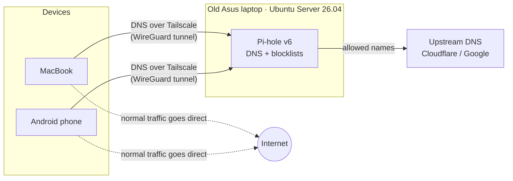
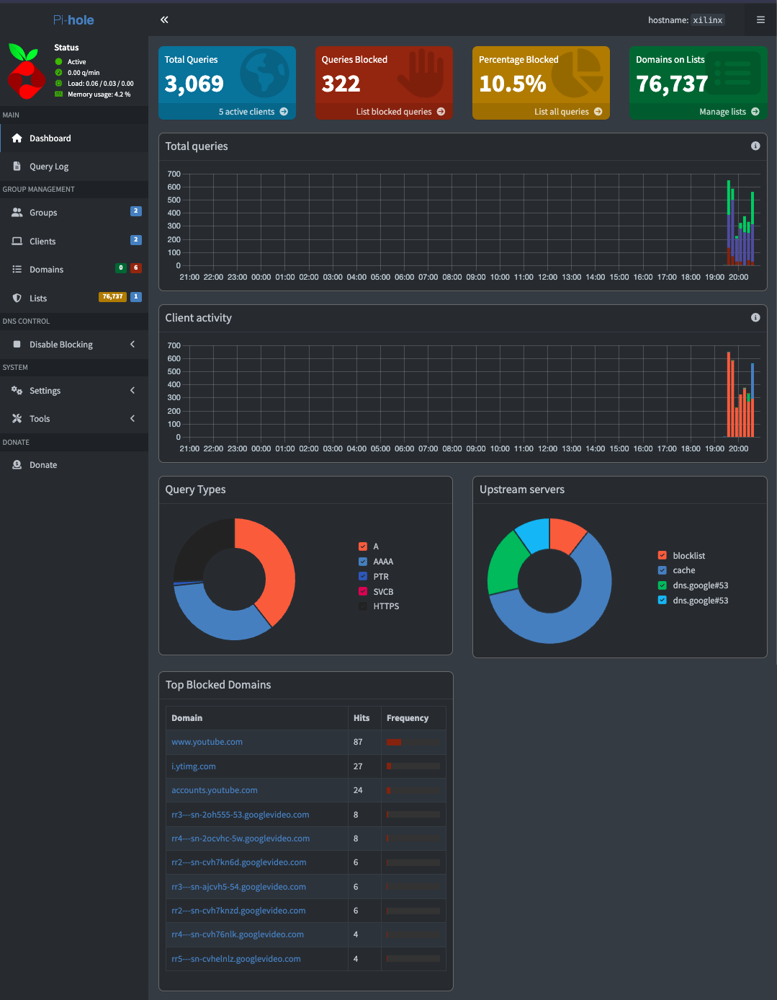

# Home Focus Switch

A one-tap **social media on/off switch** for my own devices, built on an old laptop turned into a home server.

- **Tailscale ON** → YouTube, Instagram and friends don't load.
- **Tailscale OFF** → everything works normally.

I kept reaching for social media without thinking. Willpower wasn't enough, so I made the sites simply *not open* unless I consciously flip a switch.

---

## How it works



1. Every time a device opens a site, it first asks DNS: *"what's the address of youtube.com?"*
2. With Tailscale switched on, Tailscale forces that question to go to **Pi-hole** on the home server.
3. Pi-hole checks its lists. If the site is in the **Social** group, it answers with a fake address (`0.0.0.0`). The connection goes nowhere and the site fails to load.
4. Allowed sites get forwarded to an upstream DNS server and load normally.
5. Only DNS questions go through the tunnel. Actual browsing goes straight to the internet, so there's no speed loss. (Tailscale is **not** used as an exit node.)

**Pi-hole is the engine, Tailscale is the switch.** Day to day, I never open the Pi-hole dashboard.

### It works

On day one, Pi-hole blocked 322 lookups. YouTube and its video servers (`googlevideo.com`) top the blocked list:



---

## Stack

| Piece | Role |
|---|---|
| Old Asus laptop | Always-on home server. The battery doubles as a small UPS. |
| Ubuntu Server 26.04 LTS | Headless OS, managed over SSH from my Mac |
| [Pi-hole v6](https://pi-hole.net) | DNS server that blocks domains by group |
| [Tailscale](https://tailscale.com) | Private WireGuard network. Forces DNS to Pi-hole and acts as the on/off switch |
| systemd | Keeps the server awake with the lid closed and fixes Wi-Fi power saving on boot |

---

## Repo layout

```
.
├── README.md                 ← you are here
├── docs/
│   ├── setup.md              ← full step-by-step build
│   ├── troubleshooting.md    ← every problem I hit and how I fixed it
│   └── security.md           ← what I traded off, and why it's acceptable
├── configs/
│   ├── systemd/              ← lid, DNS stub listener, Wi-Fi power-save service
│   └── netplan/              ← Wi-Fi config example (placeholders only)
├── blocklists/
│   └── social.txt            ← domains in the "Social" group
└── scripts/
    └── verify.sh             ← quick health check for the server
```

---

## Highlights from the build

The interesting part wasn't installing things, it was the debugging. Full details are in [`docs/troubleshooting.md`](docs/troubleshooting.md).

- **Installer froze on a blank screen.** `curl ... | sudo bash` meant the installer's input was the pipe, not my keyboard. Fixed by downloading the script first, then running it.
- **SSH kept dropping every few seconds.** Caused by Wi-Fi power saving on the laptop's card. Fixed with `iw ... set power_save off`, made permanent with a small systemd unit.
- **The phone completely ignored Pi-hole.** The ISP router hands out **IPv6 DNS**, and Android used it to bypass the IPv4 DNS I'd set. Fixed by routing DNS through Tailscale with *Override DNS servers*.
- **`|` typed as `#`.** The installer had set a UK keyboard layout on a US keyboard.

---

## Roadmap

- [ ] Get the router admin login from the ISP → DHCP reservation for the server, whole-house blocking
- [ ] Encrypt upstream DNS with `cloudflared` (DNS-over-HTTPS) so the ISP can't read lookups
- [ ] SSH key login, then disable password auth
- [ ] Uptime alert (e.g. Uptime Kuma → Telegram) if Pi-hole stops responding
- [ ] Turn the whole setup into a script / Ansible playbook
- [ ] Run Pi-hole and future services as Docker containers

---

## Quick start

See [`docs/setup.md`](docs/setup.md) for the full build. The short version:

1. Install Ubuntu Server on a spare machine and enable OpenSSH.
2. Apply the files in `configs/systemd/` (lid, DNS stub listener, Wi-Fi power save).
3. Download the Pi-hole installer and run it: `sudo bash basic-install.sh`.
4. Create a **Social** group in Pi-hole and add the domains from `blocklists/social.txt` as wildcards.
5. Install Tailscale on the server (`--accept-dns=false`) and on each device. Set the server's Tailscale IP as the global nameserver with **Override DNS servers** on.
6. Add each device's Tailscale IP as a Pi-hole client in **Default + Social**.
7. Flip Tailscale on and off to focus.
